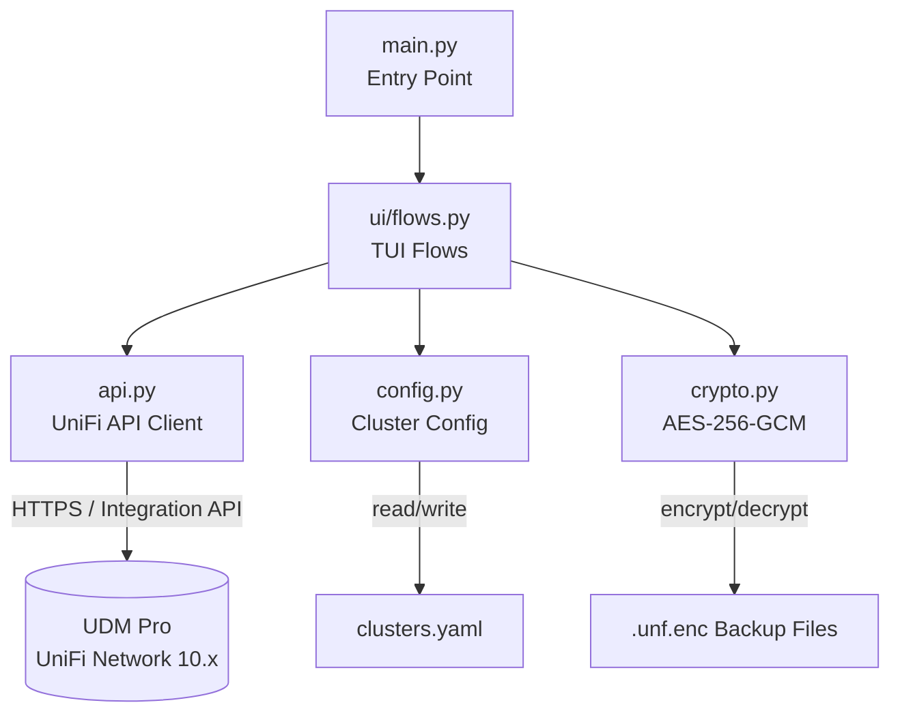
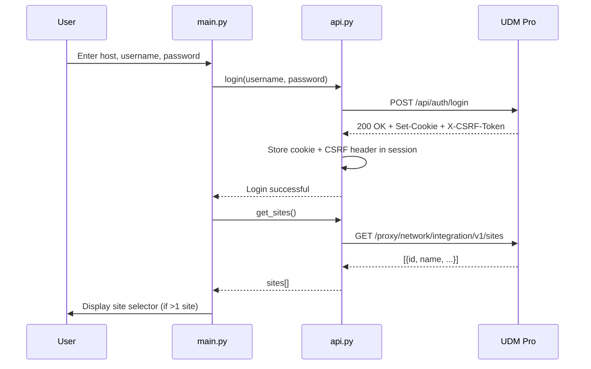
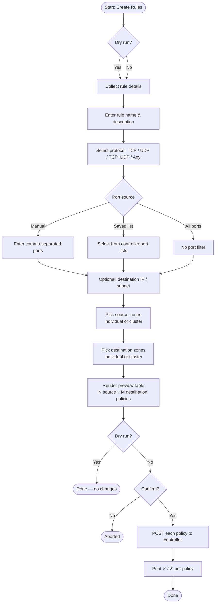
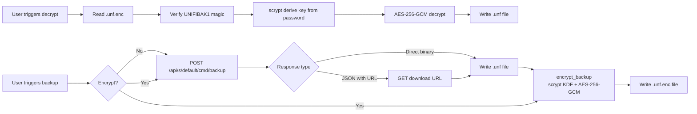

# Architecture

**Repository:** [disappointingsupernova/Unifi-Rules-to-All-Private-Zones](https://github.com/disappointingsupernova/Unifi-Rules-to-All-Private-Zones)

This document describes the structure, data flow, and component relationships of the UniFi Zone Firewall Rule Manager.

---

## Repository Structure

```
unifi-zone-manager/
├── main.py                          # Entry point — thin orchestrator
├── clusters.yaml                    # User-defined zone clusters (no credentials)
├── pyproject.toml                   # Packaging, dependencies, tooling config
├── src/
│   └── unifi_manager/
│       ├── __init__.py              # Package version
│       ├── api.py                   # UniFi Integration API client
│       ├── config.py                # clusters.yaml load/save
│       ├── crypto.py                # AES-256-GCM backup encryption
│       └── ui/
│           ├── __init__.py
│           └── flows.py             # All interactive TUI flows
├── docs/
│   └── architecture.md             # This file
└── tests/
    ├── test_crypto.py
    └── test_policy_builders.py
```

---

## Component Diagram



---

## Authentication Flow



---

## Rule Creation Flow



---

## Backup & Encryption Flow



---

## Encrypted Backup File Format

```
┌─────────────────────────────────────────────────────────┐
│  Magic bytes  │  Salt (32B)  │  Nonce (12B)  │  Ciphertext + GCM tag  │
│  "UNIFIBAK1"  │  (random)    │  (random)     │  (AES-256-GCM)         │
└─────────────────────────────────────────────────────────┘
```

Key derivation: `scrypt(password, salt, N=2^17, r=8, p=1)` → 32-byte AES key.

---

## API Endpoints Used

| Endpoint | Method | Purpose |
|---|---|---|
| `/api/auth/login` | POST | Authenticate, obtain session cookie + CSRF token |
| `/api/auth/logout` | POST | Invalidate session |
| `/proxy/network/integration/v1/sites` | GET | List sites, obtain `siteId` |
| `/proxy/network/integration/v1/sites/{siteId}/firewall/zones` | GET | List firewall zones |
| `/proxy/network/integration/v1/sites/{siteId}/firewall/policies` | GET | List existing policies |
| `/proxy/network/integration/v1/sites/{siteId}/firewall/policies` | POST | Create a firewall policy |
| `/proxy/network/integration/v1/sites/{siteId}/traffic-matching-lists` | GET | List port/IP matching lists |
| `/proxy/network/integration/v1/sites/{siteId}/traffic-matching-lists` | POST | Create a matching list |
| `/proxy/network/integration/v1/sites/{siteId}/traffic-matching-lists/{id}` | DELETE | Delete a matching list |
| `/proxy/network/api/s/default/cmd/backup` | POST | Trigger full site config backup (legacy endpoint) |
